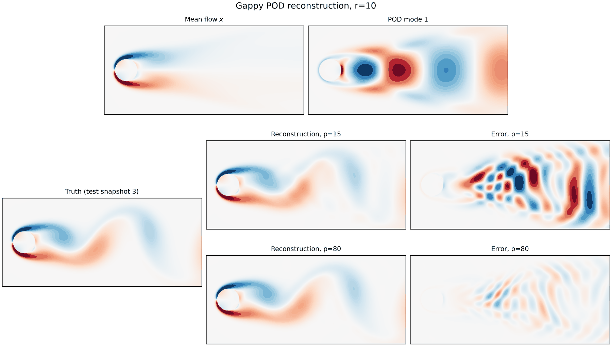
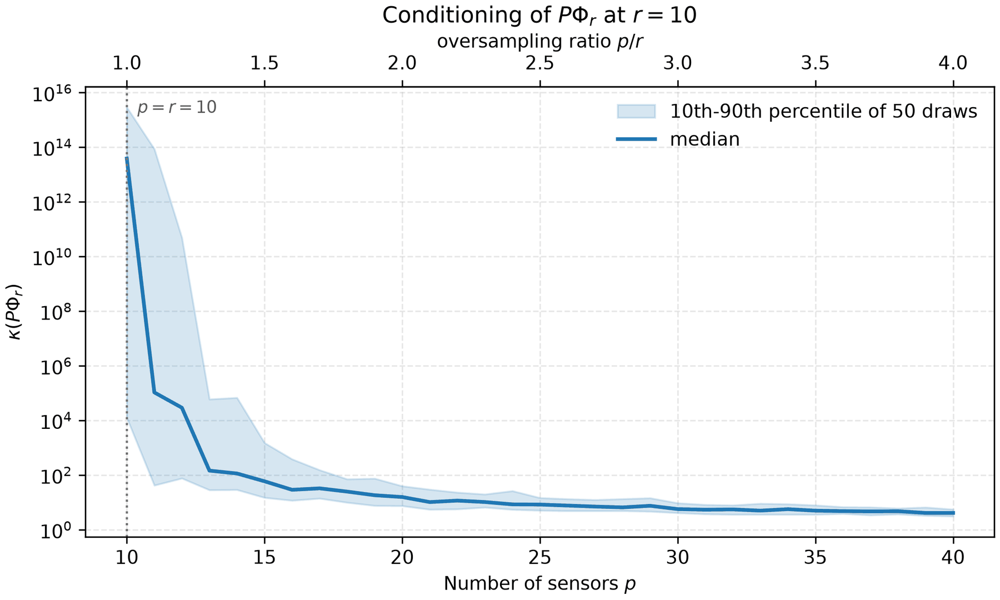
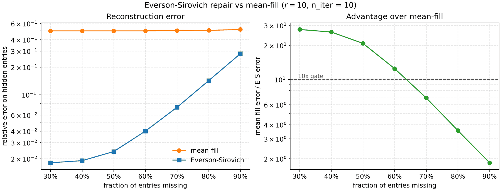
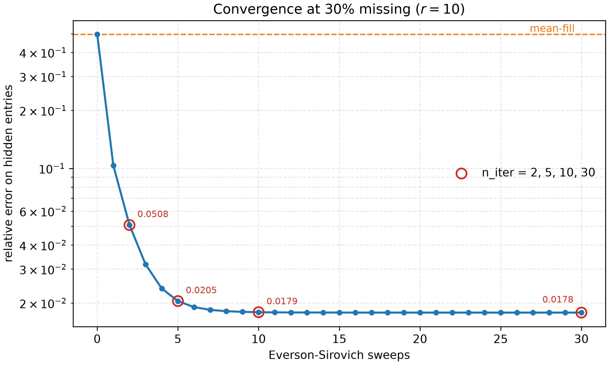

Something I didn't expect going into this: the hard part of reconstructing a fluid field is not the reconstruction, it is believing that so few measurements can be enough.

Here is the mismatch. A direct numerical simulation of flow past a cylinder hands you vorticity at 89,351 grid points, for each of 151 snapshots. A real experiment hands you a few probes, bolted wherever you could physically fit them. That gap is the entire problem of flow reconstruction, and the oldest serious answer to it is gappy POD.

The reason it works at all is that a wake is far lower-dimensional than its grid, which isn't obvious until you go and look. Take the snapshots, stack each one as a column, subtract the mean, and factor the result like we did in the SVD post. The energy collapses into a handful of modes, and everything after them is detail and noise. So the field we are chasing does not really live in \\(\mathbb{R}^{89351}\\) at all. It lives in the span of maybe ten vectors. And ten unknowns is something we can solve for with ten measurements!

Let's write that down. Let \\(\Phi_r\\) hold the first \\(r\\) POD modes as columns and let \\(\bar{x}\\) be the mean field, so that any snapshot is approximately

$$
x \approx \bar{x} + \Phi_r a,
$$

for some coefficient vector \\(a \in \mathbb{R}^r\\). Now suppose we only get to see the field at a set of sensor locations. Call \\(\Phi_r\vert_P\\) the rows of the basis at those locations, and \\(y\\) the measurements we actually have. The coefficients then fall out of a least-squares problem posed on the sensors alone,

$$
a^\star = \arg\min_a \left\| y - \bar{x}\vert_P - \Phi_r\vert_P\, a \right\|_2^2,
$$

which is the same minimisation we derived the pseudoinverse for a few posts ago, just restricted to the rows we can see. Then \\(\bar{x} + \Phi_r a^\star\\) is the reconstruction *everywhere*, including the 89,336 points nobody measured. Note that the matrix being inverted is \\(r \times r\\), not \\(89351 \times 89351\\). Nothing is ever built at full size, which is the practical reason this scales.

Two details are easy to get wrong and both cost you silently. Subtract the mean *at the sensor locations* before fitting, and add the full mean back after; fitting the raw readings gives you a basis trying to represent the mean flow as well as the fluctuation. And never build \\(P\\). It is a selection operator, rows of the identity, so `Phi[sensor_idx, :]` already *is* \\(\Phi_r\vert_P\\); materialising a \\(p \times 89351\\) matrix to achieve that is the kind of thing that turns a fast method into a slow one.

The sanity check is that with every sensor switched on, this has to collapse back to ordinary rank-\\(r\\) projection. If it doesn't, the least-squares solve is wrong somewhere. It does, to machine precision, which was a relief.

<figure>
  
  <figcaption>Top: the mean field \(\bar{x}\) and the first POD mode. Left: a held-out snapshot, the truth we are trying to recover. Centre: gappy POD reconstructions from 15 and 80 randomly placed sensors. Right: the error fields for each, on a shared scale.</figcaption>
</figure>

### My thoughts

What strikes me first is how little the two reconstructions differ to look at. Fifteen sensors and eighty sensors produce vortex streets of very similar shape and clarity, and if the error panels weren't there beside them I would have called the job done at fifteen.

The error panels are where it gets interesting. They are not noise. Both of them carry a clear periodic structure that propagates along the Kármán street, the same wavelength as the vortices themselves, just weaker at eighty sensors than at fifteen. The error is not scattered where the sensors happen to be sparse. It is locked to the flow.

I think that is forced by the method rather than incidental to it. POD is the optimal decomposition for this ensemble, so whatever a rank-\\(r\\) basis cannot represent is exactly the part of the field that was least energetic across the snapshots, and in a periodic wake that residue is itself periodic. Any reconstruction built on this basis has that periodicity implicitly encoded in it. Removing the banding would mean bringing in a prior about the field from outside the basis, something that knows about the physics rather than about the covariance of the training set.

## Where it breaks

Sweeping the sensor count is what turns this from a demonstration into a measurement, and it is the part I was most curious about. The quantity worth watching is not the error directly but the conditioning of the thing we are inverting.

Write \\(\kappa(\Phi_r\vert_P) = \sigma_{\max}/\sigma_{\min}\\) for the condition number of the sensor-restricted basis. It is the factor by which the solve can turn a small error in \\(y\\) into a large error in \\(a^\star\\), so it is a direct measure of how fragile the reconstruction is before you've measured anything at all. One side of it is pinned: \\(\Phi_r\\) has orthonormal columns, and deleting rows can only shrink a vector's norm, so \\(\sigma_{\max} \le 1\\) always. All of the drama is in how small \\(\sigma_{\min}\\) gets, which is to say, in whether the \\(p\\) rows you happened to draw still span the \\(r\\)-dimensional coefficient space properly, or nearly collapse it.

So: fix \\(r = 10\\), sweep \\(p\\), and for each \\(p\\) scatter the sensors at random fifty independent times.

<figure>
  
  <figcaption>Conditioning of \(\Phi_r\vert_P\) at \(r = 10\), over 50 random sensor draws per \(p\). The band is the 10th to 90th percentile. Note the vertical axis spans sixteen orders of magnitude.</figcaption>
</figure>

### My thoughts

This is the figure that changed how I think about sensor count, and it is much more violent than I expected. At \\(p = r\\) the median condition number sits around \\(10^{13}\\), with draws reaching \\(10^{15}\\), which is to say that at exactly ten sensors the problem is numerically useless, even though it is formally solvable. Counting unknowns tells you \\(p \ge r\\). Counting unknowns is not enough.

What I didn't anticipate was the *shape* of the recovery. It is not gradual. Between ten and about fifteen sensors the median drops roughly eleven orders of magnitude, and by twenty sensors, two per mode, it has flattened out near single digits and essentially stopped improving. Going from twenty sensors to forty buys almost nothing.

The band is the other half of the story, and arguably the more useful half. At \\(p = r\\) the spread across draws is enormous: your reconstruction is a lottery, and which ten points you happened to pick decides whether you get anything at all. The band collapses at the same rate the median does. By twenty sensors the draws agree with each other, which means the method has stopped being sensitive to luck. That is the real threshold: not where the error is acceptable, but where the *variance between placements* stops mattering.

The practical rule I take from this is to oversample by about a factor of two and never pick \\(r\\) anywhere near \\(p\\). It also sets up the obvious next question: all of this is random placement, and the whole point of choosing sensors well is to buy the same conditioning with fewer of them. That's A05's job, and I haven't run it yet, so I won't claim the result.

## Repairing a gappy ensemble

Everything above quietly assumed a clean basis to project onto, and that assumption falls over in exactly the case you care about, where the *training* snapshots are gappy too, so there was never a complete field to compute POD from in the first place.

Everson and Sirovich's answer is a fixed point, and it is a lovely one. Fill every missing entry with the mean of the observed entries at that spatial point. Compute a rank-\\(r\\) POD of the filled matrix. Re-estimate the missing entries by gappy reconstruction against that basis. Then go round again, until the estimates stop moving. The basis and the missing data refine each other, which feels like it shouldn't be allowed.

Worth being precise about what the inner solve sees, because I had it backwards at first. The least-squares fit runs on the entries that are *present*, not the ones that are missing. Each column brings its own observed set, its own \\(P\\), and its own conditioning. The gaps are never fitted. They are read off afterwards from \\(\bar{x} + \Phi_r a^\star\\) at the rows nobody measured, which is the same trick as the sensor problem, applied column by column to a matrix instead of once to a snapshot. The only extra rule is that observed entries are never overwritten. They are what anchors the iteration; without them the zero matrix is rank-\\(r\\) and fits perfectly.

The baseline to beat is the mean-fill you started from. Here is both, swept across how much of the training ensemble has been deleted.

<figure>
  
  <figcaption>Everson–Sirovich repair against the mean-fill baseline it starts from, at \(r = 10\) and ten sweeps. Left: relative error on the hidden entries alone. Right: the advantage over mean-fill, against the 10× line the assignment asks you to find.</figcaption>
</figure>

### My thoughts

Everson–Sirovich beats mean-fill at every missing fraction I tested, which I expected, but the margin and where it goes are the interesting part. At 30% missing it is roughly twenty-eight times better; the advantage decays smoothly and crosses ten times at around 65% missing. So the honest headline is that you can delete nearly two-thirds of a training ensemble and still recover the hidden entries an order of magnitude better than the laziest possible fill.

The left panel is what makes the right panel readable, and I wouldn't have trusted the ratio without it. Mean-fill is *flat*: it sits near 0.5 whether you delete 30% of the matrix or 90% of it. That makes sense in hindsight: averaging the observed entries at a spatial point is a decent estimate of that point's mean from very few samples, and getting fewer samples barely degrades it, because the mean was never a good model of a fluctuating field in the first place. It is uniformly mediocre by construction. Which means the falling ratio is entirely Everson–Sirovich degrading, not the baseline improving, and the 10× crossing is a real statement about the method rather than an artefact of dividing two moving things.

The limiting case worth naming is 100% missing, where there is nothing to anchor the iteration and the whole thing is meaningless. It's not a case anyone cares about practically, but it tells you what the method is actually living on: not the rank assumption, but the observed entries holding the estimate in place while the basis refines.

### How fast it settles

One run of thirty sweeps visits every state a shorter run would have stopped at, because the iteration is deterministic. So \\(n_{\text{iter}} = 2, 5, 10, 30\\) are four points on one curve rather than four separate experiments, a nice saving, and the reason this figure cost one run instead of four.

<figure>
  
  <figcaption>Error on the hidden entries after each sweep, at 30% missing and \(r = 10\). Sweep zero is the mean-fill initialisation. The circled points are the four iteration counts the assignment asks you to compare.</figcaption>
</figure>

The curve is monotone and it flattens by about eight sweeps: sitting at 0.0508 at two, 0.0205 at five, 0.0179 at ten, 0.0178 at thirty. So by ten sweeps the curve is already at a floor and the following twenty iterations don't contribute anything noticeable. The rank is reduced to 10 in this example, so a rank-10 basis collapses at 10 iterations in this setup, so any remaining recovery is a byproduct of truncation, but not incomplete convergence.

## Conclusion

The takeaway from this work is that "enough measurements" is not a counting question. Ten unknowns and ten sensors is formally solvable and numerically useless; the figure that shows it spans sixteen orders of magnitude. So what matters is whether the rows observed happen to span the space we're solving in.

Both halves of this project turned out to be the same question. The sensor problem asks whether \\(p\\) scattered rows span the \\(r\\)-dimensional coefficient space. Everson–Sirovich asks it of each column's observed entries, and answers badly at first and better each sweep. In both cases the failure wasn't noise, it was a basis that was incorrect.

The code for this is `a04-gappy-pod` in my flow-reconstruction assignment ladder, which will be on my GitHub at some point. The cylinder-wake DNS is the canonical dataset from Brunton and Kutz, [Data-Driven Science and Engineering](http://databookuw.com/). The iterative repair is from Everson and Sirovich's gappy POD work, by way of Willcox (2006) and Venturi and Karniadakis (2004). If you want to derive the least-squares step from first principles before reading the solution, the pseudoinverse post is the place to start.
